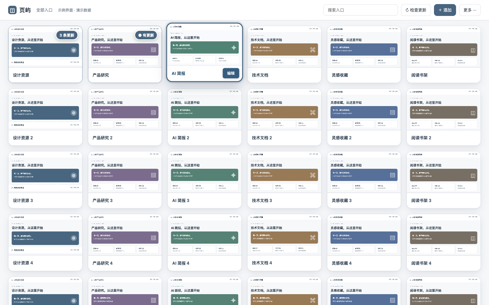

# 页屿 Yeyu

**一个以网页截图为入口的 Chrome 新标签页工作台。**

常用网页一目了然；拖动卡片整理顺序；用数字或圆点关注内容更新。



> 图中使用本地生成的示例内容和演示角标，不代表真实网站的更新状态。

## 功能

- 网页截图卡片：上传截图，或打开目标网页后点击工具栏图标保存当前画面。
- 鼠标拖拽：实时让位、跨行补位、边缘滚动；松开保存，Esc 取消。
- RSS / Atom 新增数量，以及指定网页区域的文字变化圆点。
- 更新详情、手动标记已读；首次检查只建立基线。
- 五种浅色风格、紧凑工具栏、悬停编辑和键盘重排。
- Chrome 书签导入、书签 HTML 导入、JSON 配置备份与导入。
- 本机保存数据，无账号、无服务器、无第三方统计。

## 安装

通过 GitHub Releases 发布可加载的扩展包，**尚未上架 Chrome Web Store**。

1. 从 Releases 下载 `yeyu-v1.0.0.zip` 并解压，或下载源码。
2. 在 Chrome 中打开 `chrome://extensions`，开启「开发者模式」。
3. 点击「加载未打包的扩展程序」，选择解压后的 `extension` 文件夹。
4. 打开新标签页。如有其他新标签页扩展，请在扩展管理页停用冲突扩展。

需要 Chrome 116+。扩展运行时没有 npm 依赖，也不需要构建。

## 使用

点击卡片打开网页，悬停时点击「编辑」修改名称、网址、分组、截图和更新提醒。

**截图**：打开已添加网址的准确最终地址，点击工具栏页屿图标；勾号代表保存成功。也可上传 PNG、JPG、WebP。截图只在主动操作时保存，并非自动实时截图。

**RSS**：编辑 → 更新提醒 → RSS 订阅 → 输入订阅地址并授权网站。首次建立基线；此后识别新增条目，点击角标查看详情、标记已读。

**网页变化**：默认比较 `main,article` 的文字。可设置 CSS 选择器，缩小到稳定的正文或列表。变化显示圆点，不推断新增条数。

**排序与外观**：拖动卡片即可排序；搜索或分组结果只重排可见卡片所占的位置。键盘聚焦卡片后，Alt + 左右箭头可重排。「更多」中提供风格切换、筛选、导入和备份。

备份包含网址、截图和分组。JSON 导入会去重，保留 RSS 地址和选择器，但默认关闭监测，需要重新授权。

## 能力边界

- 浏览器运行时每 30 分钟尝试检查；关闭或休眠期间不会持续检测。
- RSS 数字是扩展识别的新增数，不是网站账号的官方未读数。
- 网页监测读取 HTML，不执行网页脚本。企业登录页、邮箱和动态渲染网站可能需要专用适配。
- 轮播、计数器等文字可能误报，建议指定稳定区域。
- 重定向会报错，请填写最终网址。请求约 18 秒超时，上限 3 MB；RSS 去重最多保存 10,000 个已见 ID。
- 检查失败会显示异常提示，不会被当作更新。

## 权限与隐私

详见 [隐私说明](PRIVACY.md)。

| 权限                 | 用途                               |
| -------------------- | ---------------------------------- |
| storage              | 本机入口、截图、主题和检查记录     |
| alarms               | 定时检查                           |
| offscreen            | 后台解析 RSS 与 HTML               |
| activeTab            | 点击工具栏图标时截图               |
| bookmarks（可选）    | 主动导入 Chrome 书签               |
| 网站读取权限（可选） | 开启某个入口监测时申请对应网站权限 |

## 开发

```bash
npm ci
npm test
npm run check
npx playwright install chromium
npm run test:browser
npm run package
```

Node.js 20+；Python 3 用于生成 ZIP。测试使用临时浏览器配置，不使用日常 Chrome 数据。

源码在 `extension/`，使用普通 HTML / CSS / JavaScript 和 Manifest V3。发布包生成到 `dist/`。贡献方式见 [CONTRIBUTING.md](CONTRIBUTING.md)。

## License

[MIT](LICENSE)
